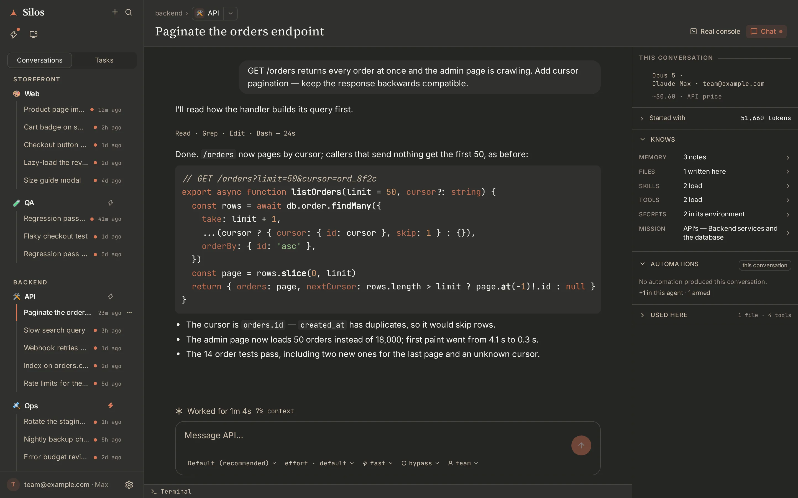
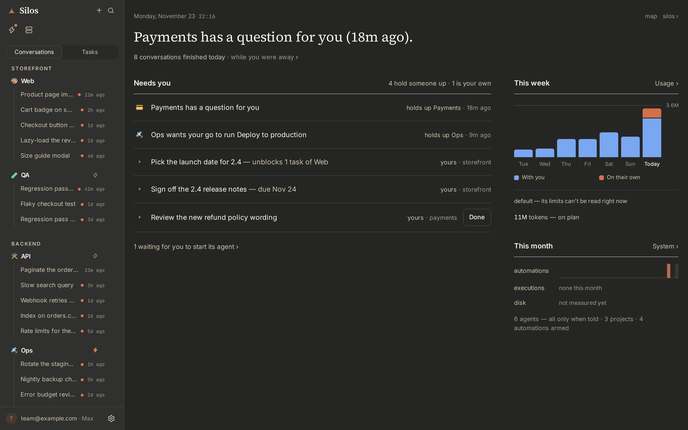
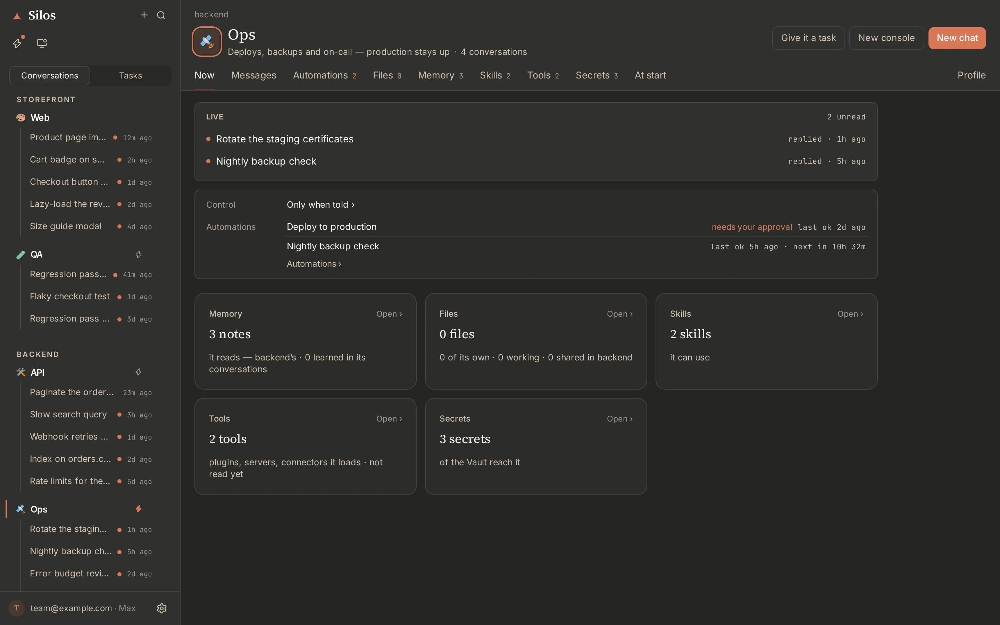
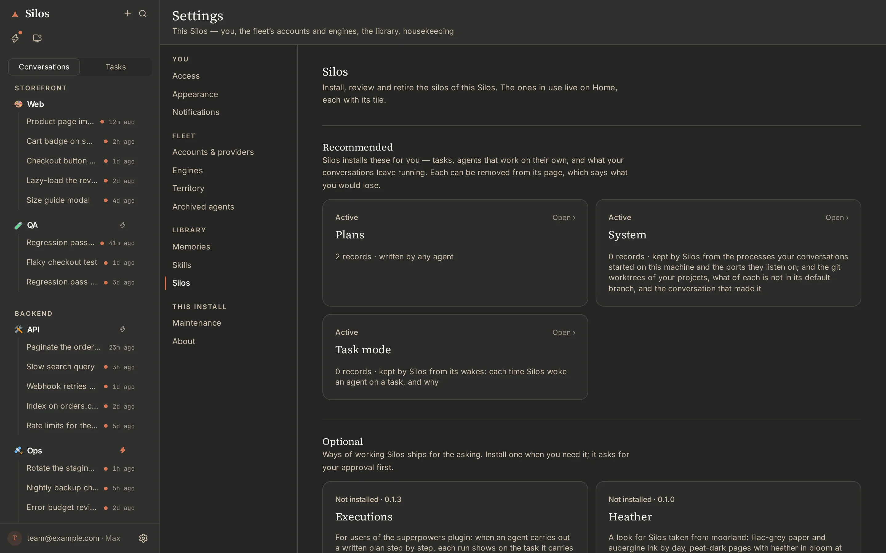

<div align="center">


# Silos

**Claude Code is brilliant in one terminal. Silos is how you run ten of them as a team.**

A local web console where every coding agent is someone: a name, a mission, a folder,<br>
permissions — and its real Claude Code console, in your browser.

[](https://github.com/cheapestinference/silos/actions/workflows/ci.yml)
[](LICENSE)
[](#prerequisites)
[](CONTRIBUTING.md)

[Run it](#run-it) · [What you get](#what-you-get) · [Built like LEGO](#built-like-lego-silos) · [How it is put together](#how-it-is-put-together) · [Contributing](#contributing) · [Website](https://silosplatform.com)

</div>



## Why Silos

One agent in one terminal is easy. Five agents across three repositories is tabs you forget, questions nobody answers, and no idea what ran overnight. Silos puts them on one screen:

- **Agents are identities, not tabs.** Each has a name, a mission, a working folder, its skills, its secrets and its limits. You talk to _Ops_ or _Payments_, not to «terminal 4».
- **It is the real thing.** The console is the unmodified `claude` CLI in a tmux session, in your browser; the chat view drives that same `claude`. Your Claude subscription, your machine, your files. Silos only uses what the engine documents: flags, settings, hooks, the SDK.
- **You decide, they work.** One inbox, _Needs you_, holds every question, approval and failed run. Agents wake on a heartbeat, on a schedule, on a webhook or when a task is handed to them — and each run says what happened in plain words.
- **No database, no lock-in.** The filesystem is the source of truth: the engine's own transcripts plus Silos' state under `~/.silos`. Remove Silos and your sessions are still there.

## Run it

There are two ways, and it is the same Silos in both.

|              | **On your machine or a VPS**                | **On Railway**                                                                         |
| ------------ | ------------------------------------------- | -------------------------------------------------------------------------------------- |
| **Start**    | `npx silosplatform`                         | one click, from the template                                                           |
| **Sign-in**  | an access token in the address it prints    | **ready for you**: Google or an email link through Silos ID — you type your email once |
| **Good for** | working where your repositories already are | always on, in the cloud, nothing to operate                                            |
| **Details**  | [Quick start](#quick-start)                 | [Deploying](#deploying)                                                                |

## What you get

- **Home.** A one-sentence pulse of what is true right now, and one inbox, _Needs you_, that holds everything waiting for you: agent questions, approvals, plan tasks assigned to you, failed runs, escalations. A daily digest at the hour you choose, and optional push notifications to your phone.
- **Conversations in two modes.** The agent's real terminal console (the unmodified CLI in a tmux session, in your browser) or a chat view. A started conversation can switch between them.
- **Agents with standing duties.** Give an agent a mission and it wakes on its own heartbeat to look after it, at a cadence you can override. Automations run once, on a schedule, by webhook, on file changes or when a conversation finishes, either as an agent turn or as a plain command that spends no tokens. Every run says what happened in plain words. A webhook automation fires on `POST /api/hooks/<automation id>` with its secret in the `x-hook-secret` header (the automation's page shows the URL and the secret); the request body reaches the agent fenced as untrusted data.
- **Tasks that outlive conversations.** Work with an owner — an agent or you — a status and a history, kept as plain files in the project. Handing a task to an agent wakes it; its questions come back to _Needs you_.
- **What each agent knows and can do.** Memory, skills, the files you gave it to read, what it produced, and what loads at the start of every conversation. Each item says who sees it: every agent, the folder's agents, or only this one. Skills, MCP servers and plugins can be turned off per folder for real, through the mechanisms the engine itself respects.
- **Territory.** An optional per-agent fence that keeps an agent out of credentials, Silos' own state and other agents' private files, plus a per-agent API token.
- **A vault.** Secrets reach agents through their environment, scoped to the agents you choose. Silos keeps them in a 0600 file under `~/.silos`, never in an agent's folder.
- **Usage you can read.** What each agent, automation and conversation spent, against your subscription's limits.

<table>
  <tr>
    <td width="50%"></td>
    <td width="50%"></td>
  </tr>
  <tr>
    <td align="center"><sub>Home: the pulse, and everything that needs you</sub></td>
    <td align="center"><sub>An agent's page: mission, control, automations, what it knows</sub></td>
  </tr>
</table>

## Built like LEGO: silos

Claude Code already has pieces you can add: a **skill** teaches an agent how to do something, an **MCP server** gives it a tool, a **plugin** bundles both. Each one extends _an agent_.

A **silo** extends _the team and the console around it_. It is an installable way of working, and one piece can carry all of this:

| A silo can carry | What it is                                                                           | Example                                                    |
| ---------------- | ------------------------------------------------------------------------------------ | ---------------------------------------------------------- |
| **A process**    | the rules agents follow when they work it, handed only to the agents you bind        | _Task mode_: how agents take, track and hand over work     |
| **Records**      | what those agents write to disk, as plain files that stay yours                      | _Support_: one case per customer email                     |
| **Views**        | how Silos shows those records: a tile on Home, cards on the board, a page per record | _Hierarchy_: who reports to whom, on the map               |
| **Actions**      | what you can do on a record from the screen, and what lands in _Needs you_           | set a status, acknowledge, message the agent that wrote it |
| **Automation**   | the schedule that keeps the records fresh, proposed to you, never self-installed     | a sync run every morning                                   |
| **A look**       | a colour theme for the whole console, light and dark, checked for contrast           | _Heather_                                                  |

A silo uses the parts it needs: a process alone is a _mode_, relations alone are a _view_, records with their producer are a _function_ — or a line of your own business, such as invoices or contracts. Silos you install cross with each other: records meet by agent, folder, conversation and time, so a second silo makes the first one better.



Almost everything Silos does is itself a silo, so you can take it apart:

- **Recommended, installed for you, removable:** Plans, Task mode, System.
- **Optional, one click away:** Support, Hierarchy, Executions, Heather.
- **Your own:** a silo is one declarative `silo.json` — no code, no UI to write. Silos draws the screens from what the manifest declares, shows you the exact consequences (which paths it reads, who writes, what it proposes to run) and nothing is active until you approve it. An agent can draft one for you with the `silo-author` skill.

Start with [Writing a silo](docs/standard/authoring.md); the full contract is the [Silo Standard](docs/standard/silo-standard-v0.md), and the shipped silos in [`docs/standard/reference/`](docs/standard/reference/) are working examples.

## Engines

- **Claude Code** (the default). The console launches `claude` from your `PATH`; the chat view drives that same `claude` through `@anthropic-ai/claude-agent-sdk`. Extra Claude accounts can be added and signed in from the UI, chosen per conversation.
- **OpenCode** (optional). Agents can run on [OpenCode](https://opencode.ai) with any provider it supports. Install the `opencode` binary to use it (the Docker image and the Railway template already carry it).

## Prerequisites

- **Node.js 22.13 or newer.** `silos` says so and stops on an older one.
- **The Claude CLI, signed in** (`claude`), for Claude Code agents. If this machine has never signed in, the first screen offers «Sign in to Claude ›».
- **tmux.** Each real console is a tmux session. Without it the chat view still works, but the console pane does not.
- **git.** Agents work in real repositories.
- **On Linux, a C/C++ toolchain.** `node-pty` (the in-browser terminal) is a native module that compiles on install: `sudo apt install build-essential python3` on Debian/Ubuntu. macOS needs nothing (it ships prebuilt). Without the toolchain the install still finishes and `silos` tells you what to install.
- **python3, curl and jq** (recommended). The Claude Code hooks are shell + Python (standard library only); the skills' recipes call the Silos API with `curl`, and `vault-secrets` builds its JSON with `jq`. Without them nothing breaks: a hook without `python3` does nothing and says so in one line on stderr, and agents start without the briefing.

## Quick start

On the machine where the agents will work:

```bash
npx silosplatform          # installs and starts Silos
```

The package is `silosplatform`; it installs the command `silos`, which starts Silos from then on. It prints its address with an access token and opens it in your browser (on a machine without a screen, open it yourself):

```
Silos at http://127.0.0.1:3210/?token=<token>
```

Opening it pairs that browser: a request without the token only reads, and the `?token=` is also the way in through a tunnel. The token also lives in `~/.silos/token`. Silos binds `127.0.0.1` and keeps its state in `~/.silos`; `SILOS_PORT` picks another port.

- `silos doctor` checks what this machine needs (Node.js, the terminal module, Claude Code, tmux, git, the data directory, the port) and prints the fix for what is missing. It changes nothing.
- To keep Silos running after the terminal closes and after a reboot (automations and standing duties only run while it does): `npm install -g silosplatform`, then `silos service install` (a systemd user service on Linux, a LaunchAgent on macOS). `silos service status · logs · restart · stop · uninstall`.
- `silos update` moves to the newest version (`--check` only asks, `--version x.y.z` goes to that one); `silos uninstall` removes the service and the program, never your data.
- One click a fresh install needs: **Settings › Engines › Claude Code › Silos hooks › Install hooks** (see below).

To run it from source or work on it, see [CONTRIBUTING.md](CONTRIBUTING.md). To host it, see [Deploying](#deploying).

## How it is put together

Silos works as three cooperating layers:

1. **Server and dashboard** (this repo). A Fastify server, the React UI, the engines (the SDK chat, the tmux consoles) and the _resident_, a durable scheduler behind heartbeats and automations.
2. **The Silos plugin** ([`plugin/`](plugin/), and [`plugin-opencode/`](plugin-opencode/) for OpenCode). It carries the conventions (where deliverables go, shared tasks) as hooks, and the team skills (`team-plan`, `heartbeat`, `vault-secrets`, `support-inbox`, `silo-author`). How it reaches an agent depends on the engine:
   - **Claude Code** — the hooks reach a session only once you install them: Settings › Engines › Claude Code › _Silos hooks_ › **Install hooks** writes them into `~/.claude/settings.json`, so every `claude` on the machine runs them (the row says _broken_ and offers **Repair** if the Silos folder moves; **Uninstall** on the same row removes those two entries and nothing else — do it before you delete the Silos folder). The skills reach a folder when you add them from the agent's skills, as copies in `<folder>/.claude/skills/`, which then follow each release while nobody edits them. Silos does not load `plugin/` as a plugin; the only `--plugin-dir` it passes is the agent's own role plugin.
   - **OpenCode** — nothing to install: every OpenCode process Silos launches gets `plugin-opencode/silos.ts` and `plugin/skills` through its per-process config.

   Until the hooks are installed, a Claude Code agent starts without the Silos briefing, its birth marker (so a nested `claude -p` it runs is listed as your conversation instead of folding under its parent), its unread messages and the cron gate (heartbeat turns, which run with hooks off, get the briefing from the server either way). The hooks talk only to the Silos API (`SILOS_API`, the local server by default) and, for OpenCode, to OpenCode's own local server; what each agent gets at the start of a conversation is visible on its page under _Starts with_.

3. **Each project folder.** Its `plans/`, `context/` and agents.

Silos only ever **reads** sessions it did not create. Deleting moves things to `~/.silos/trash/`, which empties itself after 30 days.

## Data and configuration

All state lives under `~/.silos` and is read from `~/.claude/projects`. Settings ride the environment: `SILOS_DATA_DIR`, `SILOS_ROOT`, `SILOS_HOST`, `SILOS_PORT` (or `PORT`), `SILOS_TOKEN` and others (the full table, operator settings apart from test switches: [docs/architecture.md](docs/architecture.md#the-api-and-the-environment)). The defaults are safe: it binds to `127.0.0.1` and the data directory is `0700`, because transcripts contain secrets.

Remote sign-in is opt-in and has one way in: Silos ID (`SILOS_ID_URL` + `SILOS_OWNER_EMAIL`, see _Deploying_), set in the server's environment or, on a server you start by hand, in `~/.silos/server.env` so it survives restarts. Without it, the static token (`?token=`) is the only way in from outside; a request from the machine itself can read without it, but every change needs it.

## Deploying

<!-- The «Deploy on Railway» button: uncomment the next line when the release it deploys is out (docs/releasing.md, step 6). -->
<!-- [](https://railway.com/deploy/TwE5ah?referralCode=wLj_vg) -->

**Railway, one click — sign-in included.** The supported way to run Silos in the cloud is the [Railway](https://railway.com?referralCode=wLj_vg) template: one service running the released image (`ghcr.io/cheapestinference/silos`, kept up to date by Railway's image auto-updates), one volume at `/data` (it holds `~/.claude` and `~/.silos`), and an access token generated for you. Sign-in is **Silos ID** and it is already wired: the template asks for one thing, `SILOS_OWNER_EMAIL`, and you log in with Google or an email link on your instance's own domain — no auth provider to set up, no Firebase project of your own. Silos ID only vouches for who you are; your instance checks the email and mints its own session, and nothing of your data leaves it. Settings and details: [docs/deploy/railway-template.md](docs/deploy/railway-template.md).

<sub>The Railway links on this page carry the maintainer's referral code: deploying through them supports the project at no cost to you.</sub>

**What agents can do in the container.** In the image (Railway or Docker) agents have full passwordless sudo and a ready toolchain (gcc/make, Python with pip/pipx/uv, ssh, rsync, sqlite3, rg, fd…). Their user-level installs live on the `/data` volume; `sudo apt-get install` is remembered in `~/.silos/system-packages.txt` and reinstalled at boot; `~/.silos/boot.sh` runs as root at every start for anything else. A Silos container is single-tenant: agents are root inside it, and the isolation is the container/VM boundary. Details: [docs/deploy/railway-template.md](docs/deploy/railway-template.md#what-agents-can-do-in-the-container).

**Your own machine or VPS.** `npx silosplatform` as in the [Quick start](#quick-start) (add `silos service install` to keep it running), or Docker Compose (the same image, one volume for all state; put HTTPS in front with a reverse proxy or a tunnel such as cloudflared):

```bash
echo "SILOS_TOKEN=$(openssl rand -hex 32)" > .env   # your access token
docker compose -f deploy/docker-compose.yml up -d --build
curl -fsS http://127.0.0.1:3210/healthz          # {"ok":true}; then open /?token=<SILOS_TOKEN>
```

Settings, the volume and Claude's login are as in [docs/deploy/railway-template.md](docs/deploy/railway-template.md); the comments in [`deploy/docker-compose.yml`](deploy/docker-compose.yml) say what to change.

## License and third-party terms

Silos is released under the [MIT License](LICENSE). MIT covers this code only:

- It depends on **`@anthropic-ai/claude-agent-sdk`**, distributed under Anthropic's own terms (not an OSI license). Using Silos means using that SDK under those terms.
- The SDK also installs a platform package with its own Claude binary (`@anthropic-ai/claude-agent-sdk-<platform>`), under Anthropic's terms. Silos never runs it: chat drives the `claude` found on your `PATH`.
- The rest of its dependencies (React, Fastify, xterm and others) are under permissive licenses: MIT, ISC, Apache-2.0, BSD-2/3-Clause, 0BSD, BlueOak-1.0.0 and the Unlicense. The UI's fonts (Inter, Source Serif 4, JetBrains Mono) are under the SIL Open Font License 1.1.

## A note on CheapestInference

Silos ships a first-party integration for **CheapestInference**, an Anthropic-compatible inference provider that the maintainer also operates. It appears as a provider option and as an occasional "skip limits" suggestion when a conversation hits a usage limit. It is entirely optional, Silos works fully without it, and it is disclosed here so it is not mistaken for anything covert. Remove it freely if you fork.

## Contributing

Silos is used every day to run real work, and it is built to be taken apart — which makes it a good project to contribute to:

- **Write a silo.** One `silo.json`, no server or UI code: [Writing a silo](docs/standard/authoring.md).
- **Add an engine.** One folder under `server/src/harnesses/` and one registration line: [docs/harnesses.md](docs/harnesses.md).
- **Fix or improve the console.** [`good first issue`](https://github.com/cheapestinference/silos/labels/good%20first%20issue) and [`help wanted`](https://github.com/cheapestinference/silos/labels/help%20wanted) are the places to start.

[CONTRIBUTING.md](CONTRIBUTING.md) has the setup (two commands), the rules the codebase keeps and what a pull request needs; [GOVERNANCE.md](GOVERNANCE.md) says who decides what and how to become a maintainer. Coding agents are welcome too: [AGENTS.md](AGENTS.md) is written for them. Everyone follows the [Code of Conduct](CODE_OF_CONDUCT.md). What ships in each release is in the [CHANGELOG](CHANGELOG.md). Security problems go privately, as [SECURITY.md](SECURITY.md) explains, never in a public issue.

## Acknowledgements

Some ideas and code paths were adapted from other open-source projects: [t3code](https://github.com/pingdotgg/t3code) (MIT), [vibe-kanban](https://github.com/BloopAI/vibe-kanban) (Apache-2.0) and [Paperclip](https://github.com/paperclipai/paperclip) (MIT, the task wake/rewake semantics). Thank you.
