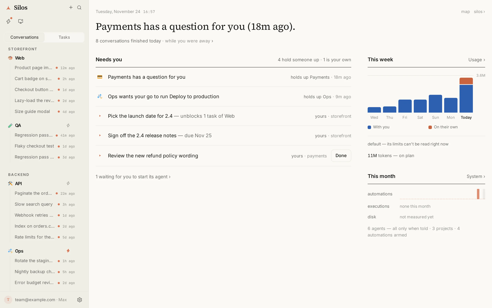
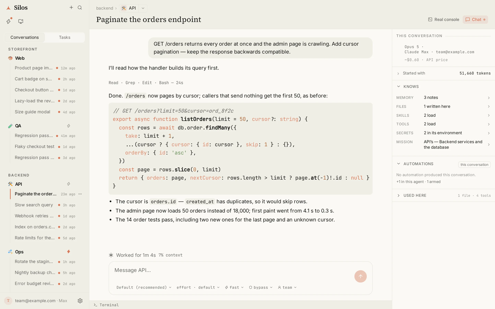
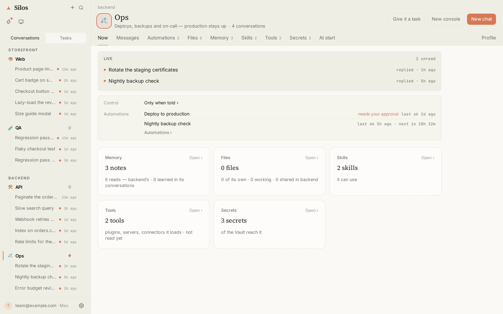

<div align="center">


# Silos

**Run a fleet of coding agents as a team you can see — from one local web console.**

[](https://github.com/cheapestinference/silos/actions/workflows/ci.yml)
[](LICENSE)
[](#prerequisites)

[What you get](#what-you-get) · [Quick start](#quick-start) · [How it is put together](#how-it-is-put-together) · [Deploying](#deploying) · [Contributing](#contributing)

</div>

Silos is a local web console for running coding agents (Claude Code, OpenCode) as **identities**. Each agent has a name, a role, its skills, a working folder, its permissions, and its conversations. You see what is happening, decide what is yours to decide, and hand out work in a sentence, without living on top of the agents.

It runs on your own machine. The filesystem is the source of truth: the agents' own session transcripts plus Silos' state under `~/.silos`. There is no database.

<picture>
  <source media="(prefers-color-scheme: dark)" srcset="docs/images/home-dark.webp">
  
</picture>

## What you get

- **Home.** A one-sentence pulse of what is true right now, and one inbox, _Needs you_, that holds everything waiting for you: agent questions, approvals, plan tasks assigned to you, failed runs, escalations. A daily digest at the hour you choose, and optional push notifications to your phone.
- **Conversations in two modes.** The agent's real terminal console (the unmodified CLI in a tmux session, in your browser) or a chat view. A started conversation can switch between them.
- **Agents with standing duties.** Give an agent a mission and it wakes on its own heartbeat to look after it, at a cadence you can override. Automations run once, on a schedule, by webhook, on file changes or when a conversation finishes, either as an agent turn or as a plain command that spends no tokens. Every run says what happened in plain words. A webhook automation fires on `POST /api/hooks/<automation id>` with its secret in the `x-hook-secret` header (the automation's page shows the URL and the secret); the request body reaches the agent fenced as untrusted data.
- **What each agent knows and can do.** Memory, skills, the files you gave it to read, what it produced, and what loads at the start of every conversation. Each item says who sees it: every agent, the folder's agents, or only this one. Skills, MCP servers and plugins can be turned off per folder for real, through the mechanisms the engine itself respects.
- **Territory.** An optional per-agent fence that keeps an agent out of credentials, Silos' own state and other agents' private files, plus a per-agent API token.
- **A vault.** Secrets reach agents through their environment, scoped to the agents you choose. Silos keeps them in a 0600 file under `~/.silos`, never in an agent's folder.
- **Silos — installable ways of working.** Silos is built like LEGO: almost everything it does is a silo, a piece you add or take away. A silo can carry rules for the agents that work it, the records they keep, and how Silos shows those records and what you can do on them — all three, or only some. So a silo can be a mode (Task mode: how agents take and hand over work), a view (Hierarchy: who reports to whom), a function (Support: cases opened from a mailbox) or your own records, written against the standard. The recommended ones (Plans, Task mode, System) come installed and can be removed; the optional ones (Support, Hierarchy, Executions, Heather) are one click away; your own you paste as a manifest. You always approve the consequences first. See [Writing a silo](docs/standard/authoring.md).

<table>
  <tr>
    <td width="50%"></td>
    <td width="50%"></td>
  </tr>
  <tr>
    <td align="center"><sub>A conversation, with what the agent knows beside it</sub></td>
    <td align="center"><sub>An agent's page: mission, control, automations, what it knows</sub></td>
  </tr>
</table>

## Engines

- **Claude Code** (the default). The console launches `claude` from your `PATH`; the chat view drives that same `claude` through `@anthropic-ai/claude-agent-sdk`. Extra Claude accounts can be added and signed in from the UI, chosen per conversation.
- **OpenCode** (optional). Agents can run on [OpenCode](https://opencode.ai) with any provider it supports. Install the `opencode` binary to use it (the Docker image and the Railway template already carry it).

## Prerequisites

- **Node.js 22.13 or newer.** `silos` says so and stops on an older one.
- **The Claude CLI, signed in** (`claude`), for Claude Code agents. If this machine has never signed in, the first screen offers «Sign in to Claude ›».
- **tmux.** Each real console is a tmux session. Without it the chat view still works, but the console pane does not.
- **git.** Agents work in real repositories.
- **On Linux, a C/C++ toolchain.** `node-pty` (the in-browser terminal) is a native module that compiles on install: `sudo apt install build-essential python3` on Debian/Ubuntu. macOS needs nothing (it ships prebuilt). Without the toolchain the install still finishes and `silos` tells you what to install.
- **python3, curl and jq** (recommended). The Claude Code hooks are shell + Python (standard library only); the skills' recipes call the Silos API with `curl`, and `vault-secrets` builds its JSON with `jq`. Without them nothing breaks: a hook without `python3` does nothing and says so in one line on stderr, and agents start without the briefing.

## Quick start

On the machine where the agents will work:

```bash
npx silosplatform          # installs and starts Silos
```

The package is `silosplatform`; it installs the command `silos`, which starts Silos from then on. It prints its address with an access token and opens it in your browser (on a machine without a screen, open it yourself):

```
Silos at http://127.0.0.1:3210/?token=<token>
```

Opening it pairs that browser: a request without the token only reads, and the `?token=` is also the way in through a tunnel. The token also lives in `~/.silos/token`. Silos binds `127.0.0.1` and keeps its state in `~/.silos`; `SILOS_PORT` picks another port.

- `silos doctor` checks what this machine needs (Node.js, the terminal module, Claude Code, tmux, git, the data directory, the port) and prints the fix for what is missing. It changes nothing.
- To keep Silos running after the terminal closes and after a reboot (automations and standing duties only run while it does): `npm install -g silosplatform`, then `silos service install` (a systemd user service on Linux, a LaunchAgent on macOS). `silos service status · logs · restart · stop · uninstall`.
- `silos update` moves to the newest version (`--check` only asks, `--version x.y.z` goes to that one); `silos uninstall` removes the service and the program, never your data.
- One click a fresh install needs: **Settings › Engines › Claude Code › Silos hooks › Install hooks** (see below).

To run it from source or work on it, see [CONTRIBUTING.md](CONTRIBUTING.md). To host it, see [Deploying](#deploying).

## How it is put together

Silos works as three cooperating layers:

1. **Server and dashboard** (this repo). A Fastify server, the React UI, the engines (the SDK chat, the tmux consoles) and the _resident_, a durable scheduler behind heartbeats and automations.
2. **The Silos plugin** ([`plugin/`](plugin/), and [`plugin-opencode/`](plugin-opencode/) for OpenCode). It carries the conventions (where deliverables go, shared tasks) as hooks, and the team skills (`team-plan`, `heartbeat`, `vault-secrets`, `support-inbox`). How it reaches an agent depends on the engine:
   - **Claude Code** — the hooks reach a session only once you install them: Settings › Engines › Claude Code › _Silos hooks_ › **Install hooks** writes them into `~/.claude/settings.json`, so every `claude` on the machine runs them (the row says _broken_ and offers **Repair** if the Silos folder moves; **Uninstall** on the same row removes those two entries and nothing else — do it before you delete the Silos folder). The skills reach a folder when you add them from the agent's skills, as copies in `<folder>/.claude/skills/`, which then follow each release while nobody edits them. Silos does not load `plugin/` as a plugin; the only `--plugin-dir` it passes is the agent's own role plugin.
   - **OpenCode** — nothing to install: every OpenCode process Silos launches gets `plugin-opencode/silos.ts` and `plugin/skills` through its per-process config.

   Until the hooks are installed, a Claude Code agent starts without the Silos briefing, its birth marker (so a nested `claude -p` it runs is listed as your conversation instead of folding under its parent), its unread messages and the cron gate (heartbeat turns, which run with hooks off, get the briefing from the server either way). The hooks talk only to the Silos API (`SILOS_API`, the local server by default) and, for OpenCode, to OpenCode's own local server; what each agent gets at the start of a conversation is visible on its page under _Starts with_.

3. **Each project folder.** Its `plans/`, `context/` and agents.

Silos only ever **reads** sessions it did not create. Deleting moves things to `~/.silos/trash/`, which empties itself after 30 days.

## Data and configuration

All state lives under `~/.silos` and is read from `~/.claude/projects`. Settings ride the environment: `SILOS_DATA_DIR`, `SILOS_ROOT`, `SILOS_HOST`, `SILOS_PORT` (or `PORT`), `SILOS_TOKEN` and others (the full table, operator settings apart from test switches: [docs/architecture.md](docs/architecture.md#the-api-and-the-environment)). The defaults are safe: it binds to `127.0.0.1` and the data directory is `0700`, because transcripts contain secrets.

Remote sign-in is opt-in and has one way in: Silos ID (`SILOS_ID_URL` + `SILOS_OWNER_EMAIL`, see _Deploying_), set in the server's environment or, on a server you start by hand, in `~/.silos/server.env` so it survives restarts. Without it, the static token (`?token=`) is the only way in from outside; a request from the machine itself can read without it, but every change needs it.

## Deploying

<!-- The «Deploy on Railway» button goes on the next line once the template is published. -->
<!-- RAILWAY_TEMPLATE_BUTTON -->

**Railway, one click.** The supported way to run Silos in the cloud is the Railway template: one service built from the [`Dockerfile`](Dockerfile), one volume at `/data` (it holds `~/.claude` and `~/.silos`), and an access token generated for you. Sign-in is **Silos ID**: set `SILOS_ID_URL=https://auth.silosplatform.com` and `SILOS_OWNER_EMAIL=<your Google email>` and you log in with Google on your instance's own domain, with no Firebase project of your own. Silos ID only vouches for who you are; your instance checks the email and mints its own session, and nothing of your data leaves it. Settings and details: [docs/deploy/railway-template.md](docs/deploy/railway-template.md).

**What agents can do in the container.** In the image (Railway or Docker) agents have full passwordless sudo and a ready toolchain (gcc/make, Python with pip/pipx/uv, ssh, rsync, sqlite3, rg, fd…). Their user-level installs live on the `/data` volume; `sudo apt-get install` is remembered in `~/.silos/system-packages.txt` and reinstalled at boot; `~/.silos/boot.sh` runs as root at every start for anything else. A Silos container is single-tenant: agents are root inside it, and the isolation is the container/VM boundary. Details: [docs/deploy/railway-template.md](docs/deploy/railway-template.md#what-agents-can-do-in-the-container).

**Your own machine or VPS.** Run from source, or with Docker Compose (the same image, one volume for all state; put HTTPS in front with a reverse proxy or a tunnel such as cloudflared):

```bash
echo "SILOS_TOKEN=$(openssl rand -hex 32)" > .env   # your access token
docker compose -f deploy/docker-compose.yml up -d --build
curl -fsS http://127.0.0.1:3210/healthz          # {"ok":true}; then open /?token=<SILOS_TOKEN>
```

Settings, the volume and Claude's login are as in [docs/deploy/railway-template.md](docs/deploy/railway-template.md); the comments in [`deploy/docker-compose.yml`](deploy/docker-compose.yml) say what to change.

## License and third-party terms

Silos is released under the [MIT License](LICENSE). MIT covers this code only:

- It depends on **`@anthropic-ai/claude-agent-sdk`**, distributed under Anthropic's own terms (not an OSI license). Using Silos means using that SDK under those terms.
- The SDK also installs a platform package with its own Claude binary (`@anthropic-ai/claude-agent-sdk-<platform>`), under Anthropic's terms. Silos never runs it: chat drives the `claude` found on your `PATH`.
- The rest of its dependencies (React, Fastify, xterm and others) are under permissive licenses: MIT, ISC, Apache-2.0, BSD-2/3-Clause, 0BSD, BlueOak-1.0.0 and the Unlicense. The UI's fonts (Inter, Source Serif 4, JetBrains Mono) are under the SIL Open Font License 1.1.

## A note on CheapestInference

Silos ships a first-party integration for **CheapestInference**, an Anthropic-compatible inference provider that the maintainer also operates. It appears as a provider option and as an occasional "skip limits" suggestion when a conversation hits a usage limit. It is entirely optional, Silos works fully without it, and it is disclosed here so it is not mistaken for anything covert. Remove it freely if you fork.

## Contributing

Issues and pull requests are welcome — read [CONTRIBUTING.md](CONTRIBUTING.md) first, and the [Code of Conduct](CODE_OF_CONDUCT.md). What ships in each release is in the [CHANGELOG](CHANGELOG.md). Security problems go privately, as [SECURITY.md](SECURITY.md) explains, never in a public issue.

## Acknowledgements

Some ideas and code paths were adapted from other open-source projects: [t3code](https://github.com/pingdotgg/t3code) (MIT), [vibe-kanban](https://github.com/BloopAI/vibe-kanban) (Apache-2.0) and [Paperclip](https://github.com/paperclipai/paperclip) (MIT, the task wake/rewake semantics). Thank you.
